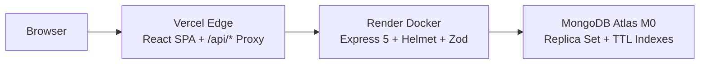

# CashDash — Full-Stack Expense Ledger & Group Debt Settlement

[](https://github.com/Nittaany/CashDash/actions/workflows/ci.yml)

[](LICENSE)
[](https://cash-dash-one.vercel.app)

> **TL;DR** — A containerized full-stack personal wallet and multi-currency (`NPR`/`INR`/`USD`) group expense settlement platform built with React 19, Vite, Node.js/Express, and MongoDB Atlas. Engineered around corporate production standards—integer minor-unit accounting, ACID database transactions, rotating `HttpOnly` auth cookies, multi-stage Docker + GitHub Actions CI/CD, and **192 automated tests (92.3% server coverage)**.

---

## Live Demo & 30-Second Reviewer Walkthrough

**[https://cash-dash-one.vercel.app](https://cash-dash-one.vercel.app)**

**Try it in 30 seconds (no signup required):**

1. Click **"Try Instant Demo (No Signup)"** to launch a private, pre-seeded sandbox (includes a sample *Pokhara Weekend Trip* group).
2. Add or delete an expense on `/expenses` to watch the personal wallet update atomically, then open the trip group to record a split or settlement and click **Export CSV**.
3. Refresh the page (`Cmd+R` / `Ctrl+R`) on `/dashboard` to verify SPA routing and same-origin `HttpOnly` cookie session persistence. Demo records self-clean automatically after 2 hours via MongoDB TTL indexes.

*The free-tier Render backend sleeps after 15 minutes of inactivity, so the first request may show a "Waking server…" state for 30–50 seconds.*

---

## At a Glance

| | |
|---|---|
| **Live App** | [cash-dash-one.vercel.app](https://cash-dash-one.vercel.app) |
| **API Health** | [cashdash-api.onrender.com/api/health](https://cashdash-api.onrender.com/api/health) |
| **Author** | Satyam Chaudhary |
| **Frontend** | React 19 + Vite 6 + Tailwind CSS + Vitest |
| **Backend** | Node.js 22 + Express 5 + Mongoose 8 + Zod 4 + Supertest |
| **Database** | MongoDB Atlas M0 Replica Set |
| **Cloud & DevOps** | Vercel Edge + Render Docker + `docker-compose.yml` + 4-job GitHub Actions CI + `gitleaks` |
| **Quality Gate** | 192 passing tests · 92.33% server statement coverage · 96 KB JS / 4 KB CSS gzip · 0 secret leaks |

---

## System Architecture & Stack Decisions



### Stack & Engineering Rationale

| Layer | Technology | Why This Choice |
|-------|------------|-----------------|
| **Frontend** | React 19 + Vite 6 + Tailwind | Fast HMR, tree-shaking, utility-first CSS with zero runtime overhead |
| **Backend API** | Express 5 + Zod 4 + Mongoose 8 | Mature async routing, compile-time-safe schema validation, MongoDB ODM with transaction support |
| **Database** | MongoDB Atlas M0 (Replica Set) | Free tier with replica set enables ACID transactions; TTL indexes auto-expire demo data |
| **Containerization** | Multi-stage Docker + Compose | Reproducible builds, non-root images, one-command local stack with auto-initialized replica set |
| **CI/CD & Cloud** | GitHub Actions + Vercel + Render | Parallel test/build/scan jobs; edge CDN for SPA; Docker container hosting with health checks |
| **Testing & Security** | Vitest + Supertest + gitleaks | Fast parallel test runner, HTTP integration tests, secrets blocked before merge |

### Repository Layout

| Path | Purpose |
|------|---------|
| `client/` | Vite + React 19 + Tailwind frontend |
| `server/` | Express 5 API, Mongoose models, Zod validation |
| `infra/jenkins/` | Parameterized `Jenkinsfile` + `Dockerfile.jenkins` (AWS S3/CloudFront reference from v1) |
| `docker-compose.yml` | Full local stack with MongoDB replica set |
| `render.yaml` | Render Blueprint for API deployment |
| `client/vercel.json` | Vercel rewrites (API proxy + SPA fallback) |
| `.github/workflows/ci.yml` | 4-job CI: secret-scan, server-test, client-test-build, docker-build |

---

## Production Engineering & Corporate Practices Built In

### Full-Stack Financial Integrity (Zero Drift, Zero Double-Pay)

**Exact money math:** All values are stored as whole integer minor units (paisa/cents) rather than floats, and `splitCalculator.js` distributes leftover cents deterministically so splits always add up to the exact bill. Locale formatting adapts automatically (`en-IN` for `NPR`/`INR`, `en-US` for `USD`).

**Atomic wallet & concurrent settlement safety:** Personal expense creation/deletion and wallet updates run inside a single MongoDB `session.withTransaction()` block so partial failures never leave balances out of sync. Group settlements validate pairwise limits and increment a `settlementVersion` counter inside a transaction so two simultaneous clicks cannot settle the same debt twice.

**Derived balances:** Group debts are computed dynamically from immutable expenses and settlements via a greedy min-cash-flow algorithm (`debtSimplifier.js`), preventing stale or orphaned balances when an expense is deleted.

### Cloud & DevOps Delivery (Reproducible Everywhere)

**Multi-stage Docker & local replica set:** Both `client/` (Nginx) and `server/` (non-root Node 22 Alpine) ship with multi-stage Dockerfiles, healthchecks, and a one-command `docker-compose.yml` that auto-initializes a local MongoDB replica set for ACID transactions (API mapped to host port `5001` to avoid macOS AirPlay on `5000`).

**Automated 4-job GitHub Actions CI:** Every push and pull request runs `gitleaks` secret scanning, server tests + `npm audit`, client tests + production build, and Docker image build verification before merge.

**Declarative cloud deploy:** Backend deploys from `render.yaml`; frontend deploys on Vercel with `client/vercel.json` proxying `/api/*` same-origin so auth cookies stay first-party (`SameSite=lax`) without cross-site cookie workarounds.

### Application Security & Startup Hygiene

**Rotating single-session auth:** Short-lived JWT access tokens (15m) pair with `HttpOnly` refresh cookies (`SameSite=lax`, scoped to `/api/auth`). Each login/refresh rotates a random `jti`, hashes it with SHA-256, verifies via `crypto.timingSafeEqual`, and invalidates the prior token.

**Fail-fast validation & abuse controls:** Zod validates both API payloads and startup environment variables (rejecting malformed `CLIENT_URL` origins before the server boots). Includes route-specific rate limiting, generic non-enumerating group invite responses, and RFC 4180 CSV export with formula-injection neutralization (`=`, `+`, `-`, `@`, `\t`, `\r`).

**Self-cleaning demo isolation:** Instant Demo records carry a 2-hour MongoDB TTL (`expiresAt`) strictly scoped via `expiryFor(user)` and verified by automated tests so normal users' data never expires.

### Automated Testing & Verification

145 backend unit, integration, concurrency, CORS, rate-limit, and TTL-safety tests + 47 frontend component/flow tests running cleanly in CI.

---

## From v1 (Cloud & DevOps) to v2 (Full-Stack Engineering)

**CashDash v1** (preserved on the [`v1` branch](https://github.com/Nittaany/CashDash/tree/v1), with parameterized reference pipeline in `infra/jenkins/`) was a successful Cloud & DevOps automation project deploying React to AWS S3 + CloudFront via Dockerized Jenkins. Auditing v1 for real public financial use surfaced backend, security, and testing needs that led to building v2 from the ground up.

| Area | v1 Cloud/DevOps Baseline | Engineered in v2 |
|------|--------------------------|------------------|
| **Backend & API Layer** | Direct browser-to-Supabase calls | Dedicated Node 22 / Express 5 REST API with Zod schema & env validation |
| **Data & Money Integrity** | Separate client wallet/expense updates & float splits | Integer minor-unit math, MongoDB ACID transactions, derived min-cash-flow settlements |
| **Security & Multi-Tenancy** | Shared user pool & early hardcoded config | Membership-scoped groups, rotating `jti` `HttpOnly` cookies, RFC 4180 CSV safety, CI `gitleaks` gate |
| **Verification & QA** | Manual pipeline validation | 192 automated server + client tests (92.3% coverage) enforced on every PR |
| **Hosting & Portability** | Retired AWS Free Tier sandbox | Permanent zero-cost Vercel + Render + Atlas stack + full local Docker Compose parity |

---

## Verification, Coverage & API Reference

### Verification Commands & Measured Results

| Command | Expected Output |
|---------|-----------------|
| `cd server && npm test` | 145 tests passing |
| `cd server && npm run test:coverage` | 92.33% statements, 92.73% lines |
| `cd client && npm test` | 47 tests passing |
| `cd client && npm run build` | 96 KB JS gzip, 4 KB CSS gzip |
| `gitleaks detect --source . --verbose` | 0 leaks found |

**Coverage highlights:** `splitCalculator.js` 94.84% · `debtSimplifier.js` 94.31%

### API Routes

| Route Group | Description |
|-------------|-------------|
| `GET /api/health` | Health check (DB status, uptime) |
| `/api/auth/*` | Register, login, refresh, logout, demo, profile |
| `/api/wallet/*` | Balance, top-up |
| `/api/expenses/*` | Personal expenses (CRUD, atomic wallet debit/refund) |
| `/api/groups/*` | Groups, members, expenses, settlements, CSV export |

<details>
<summary><strong>View Full API Reference (21 Endpoints)</strong></summary>

| Endpoint | Method | Description |
|----------|--------|-------------|
| `/api/health` | GET | Health check (DB status, uptime) |
| `/api/auth/register` | POST | Create account |
| `/api/auth/login` | POST | Login (returns access token, sets refresh cookie) |
| `/api/auth/refresh` | POST | Rotate refresh token |
| `/api/auth/logout` | POST | Clear refresh token |
| `/api/auth/demo` | POST | Create ephemeral demo account |
| `/api/auth/me` | GET | Get current user profile |
| `/api/auth/me` | PATCH | Update profile |
| `/api/wallet` | GET | Get wallet balance |
| `/api/wallet/topup` | POST | Add funds to wallet |
| `/api/expenses` | GET | List personal expenses (paginated, filterable) |
| `/api/expenses` | POST | Create expense (atomically deducts from wallet) |
| `/api/expenses/:id` | DELETE | Delete expense (atomically refunds to wallet) |
| `/api/groups` | GET | List user's groups |
| `/api/groups` | POST | Create group |
| `/api/groups/:groupId/members` | POST | Add member to group |
| `/api/groups/:groupId/summary` | GET | Group summary with simplified debts |
| `/api/groups/:groupId/expenses` | POST | Create group expense |
| `/api/groups/:groupId/expenses/:expenseId` | DELETE | Delete group expense |
| `/api/groups/:groupId/settlements` | POST | Record settlement (transaction-safe) |
| `/api/groups/:groupId/export.csv` | GET | Export expenses as CSV |

</details>

---

## Quick Start

### Option A: Docker Compose (Recommended)

```bash
docker compose up --build
```

- UI: `http://localhost:8080`
- API: `http://localhost:5001`
- MongoDB replica set auto-initialized for ACID transactions

### Option B: Local Development

```bash
# Server (port 5001)
cd server
cp ../.env.example .env  # Set MONGODB_URI (Atlas M0 or local replica set), JWT secrets
npm install && npm run dev

# Client (port 3000)
cd client
npm install && npm run dev
```

*Tip: Use Option A to auto-provision a local replica set, or point `MONGODB_URI` to a free MongoDB Atlas M0 cluster.*

---

## Design Tradeoffs & Roadmap

- **Single active refresh session:** Storing one hashed `jti` per user keeps revocation O(1). Tradeoff: signs out earlier devices. Multi-device session cap (5) on roadmap.

- **Derived-on-read group balances:** Recomputing from immutable records eliminates drift; scales for normal groups. Thousands of expenses would need periodic materialized snapshots.

- **Off-band payment settlement:** UPI / eSewa / Fonepay / cash recorded manually without payment-gateway webhooks.

- **Free-tier cold starts & UI polish:** 30–50 s Render wake on idle; container configs support instant migration to always-on hosts. UI polish + screenshots scheduled next.

---

## Branches

| Branch | Description |
|--------|-------------|
| `v2` (default) | Full-stack production application |
| `v1` | Standalone AWS/Jenkins Cloud & DevOps project |

---

## License

[MIT](LICENSE) © 2026 Satyam Chaudhary

---

<details>
<summary>Machine-readable project metadata (YAML)</summary>

```yaml
project: CashDash
version: 2.0.0
live_url: https://cash-dash-one.vercel.app
api_health: https://cashdash-api.onrender.com/api/health
repository: https://github.com/Nittaany/CashDash

stack:
  frontend: React 19, Vite 6, Tailwind CSS 3
  backend: Node.js 22, Express 5, Mongoose 8, Zod 4
  database: MongoDB Atlas M0 (Replica Set)
  auth: JWT access (15m) + jti refresh rotation (7d) + crypto.timingSafeEqual
  devops: GitHub Actions (4 jobs), Docker multi-stage, Vercel, Render

test_counts:
  server: 145
  client: 47
  total: 192

coverage:
  statements: 92.33%
  lines: 92.73%
  splitCalculator: 94.84%
  debtSimplifier: 94.31%

bundle_gzip_kb:
  js: 96
  css: 4

reproduce:
  full_stack: docker compose up --build
  server_test: cd server && npm test
  server_coverage: cd server && npm run test:coverage
  client_test: cd client && npm test
  client_build: cd client && npm run build
  secret_scan: gitleaks detect --source . --verbose
```

</details>
