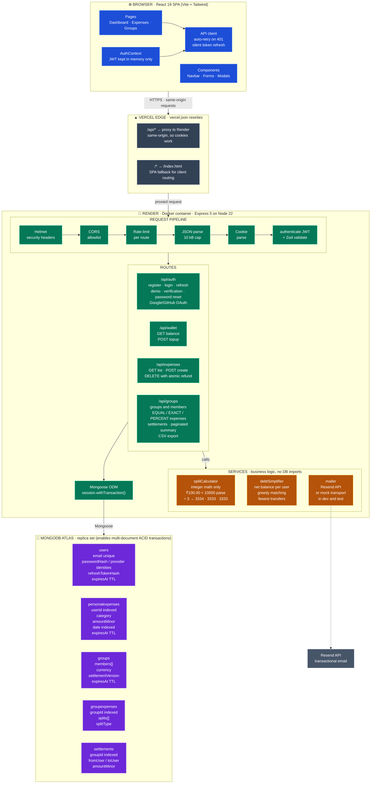

# CashDash

[](https://github.com/Nittaany/CashDash/actions/workflows/ci.yml)
[](https://cash-dash-one.vercel.app)

[](LICENSE)

> **TL;DR** — A personal wallet and group expense splitter handling NPR, INR, and USD with **integer money math** (no floating-point drift), **ACID transactions** for wallet operations, and **greedy debt simplification** that minimizes transfers. Built with React 19 + Express 5 + MongoDB, deployed on Vercel/Render/Atlas free tiers. Backed by **336 tests**, 4-job CI pipeline, and **0 secret leaks**.

**[Live Demo](https://cash-dash-one.vercel.app)** — Click "Try Instant Demo" for a pre-seeded sandbox with 25 expenses and 10 groups (no signup, 2h auto-cleanup).

---

## What It Does

```
┌─────────────────────────────────────────────────────────────────────────────┐
│                              CASHDASH                                       │
├─────────────────────────────────────────────────────────────────────────────┤
│                                                                             │
│   👤 PERSONAL WALLET              👥 GROUP EXPENSES                         │
│   ─────────────────               ────────────────                          │
│   • Track daily spending          • Split bills (equal/exact/percent)       │
│   • Categories & filters          • Multi-currency (NPR/INR/USD)            │
│   • Monthly summaries             • Debt simplification algorithm           │
│   • Atomic transactions           • Settlement tracking                     │
│                                   • CSV export                              │
│                                                                             │
│   🔐 AUTH & SECURITY              📱 UX                                     │
│   ─────────────────               ────                                      │
│   • JWT + HttpOnly cookies        • 1-click instant demo                    │
│   • Email verification            • UPI QR code generation (INR)            │
│   • Password reset flow           • Mobile-responsive UI                    │
│   • Rate limiting                 • Server wake indicator (cold starts)     │
│                                   • Real-time balance updates               │
│                                                                             │
└─────────────────────────────────────────────────────────────────────────────┘
```

---

## System Architecture



**How to read it**

- **One origin for the browser.** The SPA only talks to Vercel. Vercel rewrites `/api/*` to Render, so the refresh-token cookie is first-party and survives Safari/Chrome third-party cookie blocking.
- **Every request takes the same path.** Security headers, CORS allowlist, rate limit, body and cookie parsing, then JWT authentication and Zod validation, all before any route runs.
- **Business logic is pure.** `splitCalculator` and `debtSimplifier` import nothing from the database layer, so they are unit-tested as plain functions.
- **The replica set is deliberate.** MongoDB only supports multi-document transactions on a replica set, which is what keeps wallet debits and expense records consistent. TTL indexes delete demo data after 2 hours.

---

## Tech Stack

| Layer        | Technologies                                                           |
| :----------- | :--------------------------------------------------------------------- |
| **Frontend** | React 19, Vite 6, Tailwind CSS 3, React Router 7, ShaderGradient/Three |
| **Backend**  | Node 22, Express 5, Mongoose 8, Zod 4                                  |
| **Database** | MongoDB Atlas M0 (replica set for ACID transactions)                   |
| **Auth**     | JWT (15min), HttpOnly refresh cookies (7d), Google/GitHub OAuth       |
| **Email**    | Resend API (mock transport in dev/test)                                |
| **DevOps**   | Docker multi-stage, GitHub Actions (4 jobs), Vercel, Render            |
| **Testing**  | Vitest, Supertest, mongodb-memory-server                               |

---

## Production Auth Configuration

The Render service requires real email delivery when production email verification is enabled. Configure these values in Render's environment settings; never commit their values:

| Variable | Purpose |
| :--- | :--- |
| `REQUIRE_EMAIL_VERIFICATION=true` | Require verified email before password login or protected API access. Set in `render.yaml`. |
| `RESEND_API_KEY` | Resend API credential. Required for production verification and password-recovery email. |
| `MAIL_FROM` | Sender address verified with Resend. |
| `CLIENT_URL` | Allowed frontend origin(s), comma-separated and without trailing slashes. |
| `APP_URL` | Public Vercel origin without a trailing slash; used for email and OAuth callback URLs. |
| `GOOGLE_CLIENT_ID` / `GOOGLE_CLIENT_SECRET` | Optional Google OAuth application credentials; configure both or neither. |
| `GITHUB_CLIENT_ID` / `GITHUB_CLIENT_SECRET` | Optional GitHub OAuth application credentials; configure both or neither. |
| `OAUTH_STATE_SECRET` | Random secret of at least 32 characters used to sign short-lived OAuth state cookies. Required when either provider is configured. |

### Verified signup and account recovery

With `REQUIRE_EMAIL_VERIFICATION=true`, signup creates a temporary pending registration that expires after 24 hours. A permanent user account is created only after the one-time verification link is accepted; the user can then log in. Signup returns the same account-neutral response for eligible, existing, pending, and ineligible addresses; repeating signup does not resend a message, so use the resend-verification flow if needed.

Resend-verification and forgot-password responses are also account-neutral. A confirmation does not guarantee that an email was sent: no message may mean the address is not on file, the account is not eligible for that flow, or email delivery is temporarily unavailable. Password-reset emails go only to eligible permanent password accounts; reset links expire after 15 minutes.

Password and provider signup check the locally bundled `disposable-email-domains-js` list. This does not make an external lookup request, and the list cannot identify every temporary-email provider. MongoDB's unique normalized-email index remains authoritative for email uniqueness; names are not unique and a Bloom filter is not used.

### Signup and recovery limits

- Auth requests share an IP-based limit of 10 requests per 15 minutes.
- Signup, verification resend, and password-reset requests are limited to 3 per normalized email per hour.
- Signup and verification resend also use a resettable, first-party `cashdash_device` cookie for a 10-request per 15-minute limit. The cookie is HttpOnly, `SameSite=Lax`, scoped to `/api/auth`, and Secure in production.
- The signup form discloses this cookie. CashDash does not use passive browser fingerprinting.

Set `VITE_OAUTH_PROVIDERS` in Vercel to the comma-separated public provider list, such as `google,github`, matching the providers configured on Render. It contains provider names only, never secrets. The login/register pages do not make a backend preflight request, so they remain usable during a cold start.

Register these exact callback URLs in the provider consoles, replacing the origin with the deployed frontend origin:

```text
https://<your-vercel-domain>/api/auth/oauth/google/callback
https://<your-vercel-domain>/api/auth/oauth/github/callback
```

`client/vercel.json` proxies `/api/*` to Render so callbacks and refresh cookies stay on the browser's first-party Vercel origin. OAuth sign-in requires a provider-verified email. Existing password accounts are never linked automatically by matching email; sign in first, then link Google or GitHub from Profile. In development and tests the mailer may use its mock transport; production never falls back to mock email.

### Deployment checklist

These authentication changes are on the local `fix/verified-email-signup` branch and have not been pushed or deployed. They will not affect the live app until the branch is integrated into `v2` and both services are deployed.

- [ ] In Render, set `RESEND_API_KEY`, `MAIL_FROM`, `APP_URL`, and `CLIENT_URL`; keep `REQUIRE_EMAIL_VERIFICATION=true`. Verify the sender domain with Resend. Never put credential values in source control.
- [ ] If enabling Google or GitHub, configure each provider's client ID and secret plus `OAUTH_STATE_SECRET` in Render, and register the callback URLs above in the provider console.
- [ ] In Vercel, set `VITE_OAUTH_PROVIDERS` to the comma-separated names of the enabled providers (`google`, `github`, or both), then redeploy the client.
- [ ] Push/integrate the feature branch into `v2`, then deploy the backend and frontend. Confirm verification, resend, and password-recovery email delivery using the production mail configuration.

---

## Engineering Challenges & Decisions

### 1. Floating-Point Money Drift → Integer Minor Units

**Problem:** `₹100 / 3` in JavaScript = `33.333...` — three of those sum to `99.999`, losing a paisa.

**Solution:** Store all amounts as integer minor units (paisa/cents). The `splitCalculator.js` divides with `Math.floor`, then distributes remainder to first N participants.

**Result:** `10000` split 3 ways → `[3334, 3333, 3333]` — sum always equals total.

### 2. Race Conditions → MongoDB Transactions

**Problem:** Creating expense = debit wallet + insert record. Two writes = lost updates if one fails.

**Solution:** `session.withTransaction()` wraps both operations. Wallet uses conditional `$inc` that fails if balance goes negative.

**Result:** 10 parallel ₹100 expenses on ₹500 wallet → exactly 5 succeed, final balance = ₹0.

### 3. Third-Party Cookie Blocking → Same-Origin Proxy

**Problem:** Safari/Chrome block cross-origin cookies. Separate API domain breaks HttpOnly refresh tokens.

**Solution:** Vercel rewrites `/api/*` to Render backend. Browser sees one origin, cookies work with `SameSite=Lax`.

**Result:** Hard-refresh on any route stays logged in.

### 4. Settlement Concurrency → Optimistic Locking

**Problem:** Two users settling same debt simultaneously could both succeed (double-pay).

**Solution:** `Group.settlementVersion` counter + `$inc` inside transaction. MongoDB atomicity forces one to retry and fail.

**Result:** Concurrent settlement test confirms only one succeeds.

### 5. Demo Blast Radius → TTL Isolation

**Problem:** Anyone can create demo user. Without isolation, could fill 512MB free database.

**Solution:** Demo users get 2h TTL via MongoDB `expiresAt` index. `expiryFor(user)` propagates to all their records.

**Result:** Demo data auto-deletes; real user records never get `expiresAt`.

---

## API Reference (28 Endpoints)

| Group        | Endpoints                                                                                                      |
| :----------- | :------------------------------------------------------------------------------------------------------------- |
| **Auth**     | register, login, refresh, logout, demo, me, forgot-password, reset-password, verification, OAuth           |
| **Wallet**   | GET balance/summary, POST topup                                                                                |
| **Expenses** | GET list (filtered), POST create (atomic debit), DELETE (atomic refund)                                        |
| **Groups**   | CRUD groups, members, expenses, settlements, paginated summary, CSV exports                                    |

<details>
<summary><strong>Full endpoint list</strong></summary>

| Endpoint                        | Method | Description                         |
| :------------------------------ | :----- | :---------------------------------- |
| `/api/auth/register`            | POST   | Create account + verification email |
| `/api/auth/login`               | POST   | Authenticate + set refresh cookie   |
| `/api/auth/refresh`             | POST   | Rotate refresh token                |
| `/api/auth/logout`              | POST   | Invalidate session                  |
| `/api/auth/demo`                | POST   | Create 2h ephemeral demo account    |
| `/api/auth/me`                  | GET    | Current profile                     |
| `/api/auth/me`                  | PATCH  | Update profile                      |
| `/api/auth/forgot-password`     | POST   | Request reset email                 |
| `/api/auth/reset-password`      | POST   | Reset with 15min SHA-256 token      |
| `/api/auth/verify-email`        | POST   | Verify with 24h SHA-256 token       |
| `/api/auth/resend-verification` | POST   | Resend (anti-enumeration)           |
| `/api/auth/providers`           | GET    | List configured OAuth providers     |
| `/api/auth/oauth/:provider`     | GET    | Start Google/GitHub sign-in          |
| `/api/auth/oauth/:provider/link`| POST   | Start authenticated provider linking |
| `/api/auth/oauth/:provider/callback` | GET | OAuth provider callback              |
| `/api/wallet`                   | GET    | Balance + monthly summary           |
| `/api/wallet/topup`             | POST   | Add funds                           |
| `/api/expenses`                 | GET    | List with filters                   |
| `/api/expenses`                 | POST   | Create (atomic wallet debit)        |
| `/api/expenses/:id`             | DELETE | Delete (atomic refund)              |
| `/api/groups`                   | GET    | User's groups                       |
| `/api/groups`                   | POST   | Create group                        |
| `/api/groups/:id/members`       | POST   | Add member                          |
| `/api/groups/:id/members/:mid`  | DELETE | Remove (requires 0 balance)         |
| `/api/groups/:id/summary`       | GET    | Balances + transfers (paginated)    |
| `/api/groups/:id/expenses`      | POST   | Add group expense                   |
| `/api/groups/:id/expenses/:eid` | DELETE | Delete expense                      |
| `/api/groups/:id/settlements`   | POST   | Record settlement                   |
| `/api/groups/:id/export.csv`    | GET    | Export expenses                     |
| `/api/groups/:id/balances.csv`  | GET    | Export balances                     |
| `/api/health`                   | GET    | DB state, uptime                    |

</details>

---

## Test Coverage

```
┌─────────────────────────────────────────────────────────────────┐
│                     TEST SUMMARY                                │
├─────────────────────────────────────────────────────────────────┤
│  Server: 202 tests │                                            │
│  Client: 104 tests │                                            │
│  Total:  306 tests │ 0 secret leaks (gitleaks)                  │
│  App bundle: 111.86 kB JS │ 7.31 kB CSS (gzip)                  │
│  Lazy shader: 294.42 kB JS (gzip)                              │
└─────────────────────────────────────────────────────────────────┘
```

| Test Suite                         | What It Covers                                                  |
| :--------------------------------- | :-------------------------------------------------------------- |
| `splitCalculator.test.js`          | Integer splits, rounding, percent validation, edge cases        |
| `debtSimplifier.test.js`           | Mutual cancellation, transitive chains, partial settlements     |
| `walletAndExpenses.test.js`        | Atomic transactions, concurrent operations (10 parallel)        |
| `auth.test.js`                     | Token rotation, refresh reuse rejection, timing-safe comparison |
| `groupsAndSettlements.test.js`     | Membership checks, settlement validation, optimistic locking    |
| `emailVerification.test.js`        | Token verify, single-use rejection, expiry, anti-enumeration    |
| `oauth.test.js`                    | OAuth state/PKCE, verified emails, account collisions, linking  |
| `memberRemoval.test.js`            | Safe removal (0 balance required), authorization                |
| `ttl.test.js`                      | Demo expiry, real users never get `expiresAt`                   |
| `PaymentQRModal.test.jsx`          | Integer formatting, VPA validation, INR-only QR                 |
| `Footer.test.jsx`                  | Copyright, external links, accessibility                        |
| `ServerWakeIndicator.test.jsx`     | Wake states, progress timer, auto-dismiss                       |
| `AuthContext.test.jsx`             | Direct demo login, health state, overlapping wake operations    |
| `LoginPage.test.jsx`               | Credentials and one-click instant demo behavior                 |
| `AmbientShaderBackground.test.jsx` | Test-mode CSS fallback without WebGL                            |

---

## Quick Start

**Docker (full stack):**

```bash
docker compose up --build
# UI: localhost:8080  API: localhost:5001
```

**Local development:**

```bash
# Server
cd server && cp .env.example .env  # Set MONGODB_URI + JWT secrets
npm install && npm run dev

# Client
cd client && npm install && npm run dev
```

**Run tests:**

```bash
cd server && npm test                    # 202 tests
cd server && npm run test:coverage
cd client && npm test                    # 104 tests
gitleaks detect --source . --verbose     # 0 leaks
```

---

## Demo Data

The instant demo seeds realistic data for exploration:

| Category              | Count | Details                                  |
| :-------------------- | :---- | :--------------------------------------- |
| **Personal Expenses** | 25    | 3 months, 7 categories, 5 payment modes  |
| **Groups**            | 10    | 2-6 members each, NPR/INR/USD currencies |
| **Group Expenses**    | 25+   | EQUAL, EXACT, PERCENT splits             |
| **Settlements**       | 1     | Partial payment example                  |
| **Teammates**         | 9     | For group variety                        |

Groups include: Pokhara Trip, Flatmates, Office Lunch Club, Remote Team Offsite (USD), Wedding Gift (INR), Hiking Club, Book Club, Birthday Party, Gaming Setup, and an empty planning group.

---

## Limitations & Future Work

| Current Limitation        | Rationale                                  | Future Path                       |
| :------------------------ | :----------------------------------------- | :-------------------------------- |
| One session per user      | O(1) revocation with single hashed token   | Multi-device cap (5) + Redis      |
| Balances computed on read | No drift; correct for <1000 expenses/group | Materialized snapshots            |
| In-memory rate limiting   | Works for single instance                  | Redis-backed for horizontal scale |
| Free-tier cold starts     | 30-50s Render wake                         | Same Docker → always-on host      |

---

## Project Evolution

| Version | Focus                                   | Stack                                               |
| :------ | :-------------------------------------- | :-------------------------------------------------- |
| **v1**  | CI/CD pipeline                          | React + Supabase → Jenkins → AWS S3/CloudFront      |
| **v2**  | Full-stack app + atmospheric fintech UI | React + Express + MongoDB + Docker + GitHub Actions |

The [`v1` branch](https://github.com/Nittaany/CashDash/tree/v1) preserves the original Jenkins/AWS pipeline. v2 is a ground-up rebuild addressing security and reliability gaps.

---

## License

[MIT](LICENSE) © 2026 Satyam Chaudhary

---

<details>
<summary>Machine-readable metadata</summary>

```yaml
project: CashDash
version: 2.0.0
live_url: https://cash-dash-one.vercel.app
stack:
  frontend: React 19, Vite 6, Tailwind CSS 3
  backend: Node 22, Express 5, Mongoose 8, Zod 4
  database: MongoDB Atlas M0 (replica set)
  auth: JWT + SHA-256 hashed refresh cookie (HttpOnly)
tests:
 server: 202
 client: 104
 total: 306
bundle_gzip: { app_js: 111.86kb, css: 7.31kb, lazy_shader_js: 294.42kb }
endpoints: 28
demo_data: { expenses: 25, groups: 10 }
```

</details>
